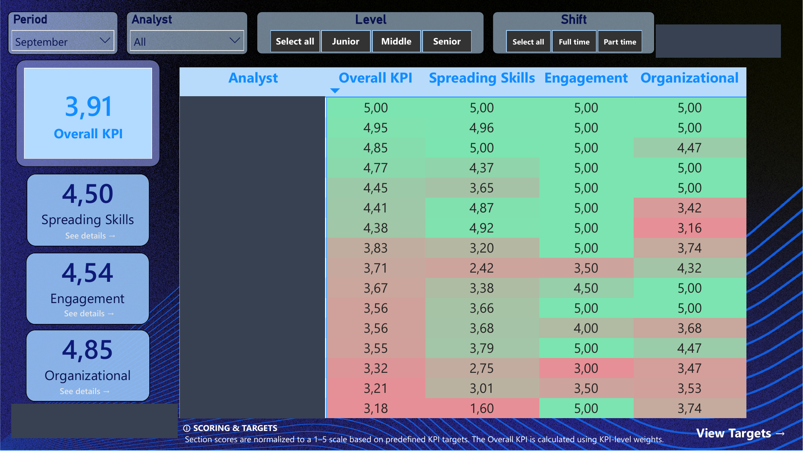
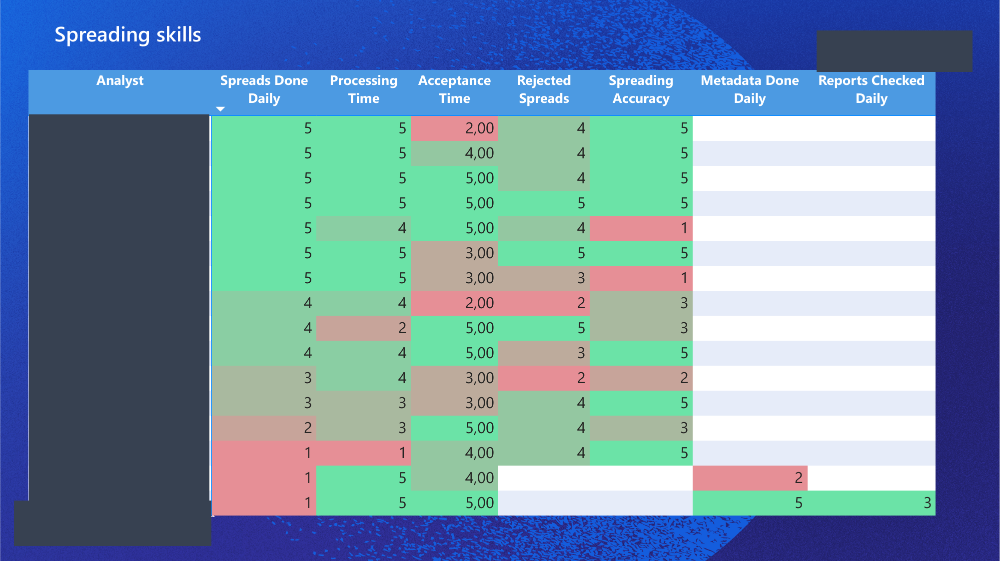
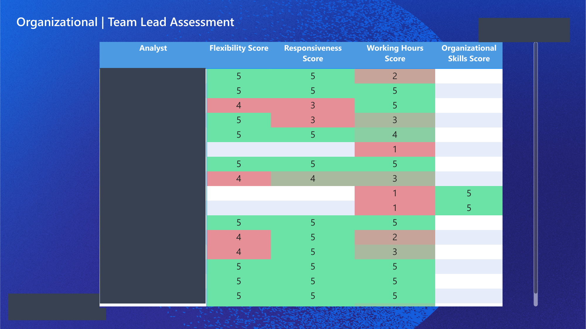
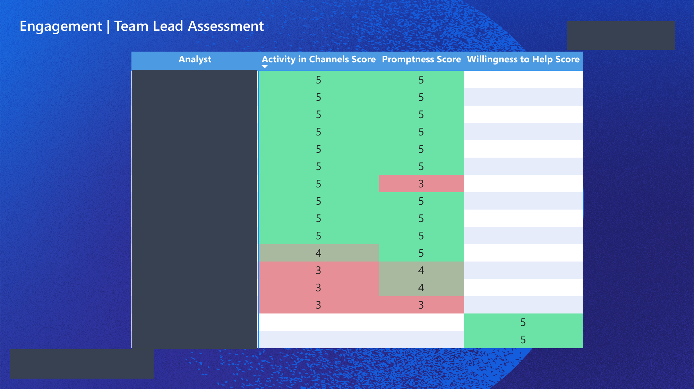
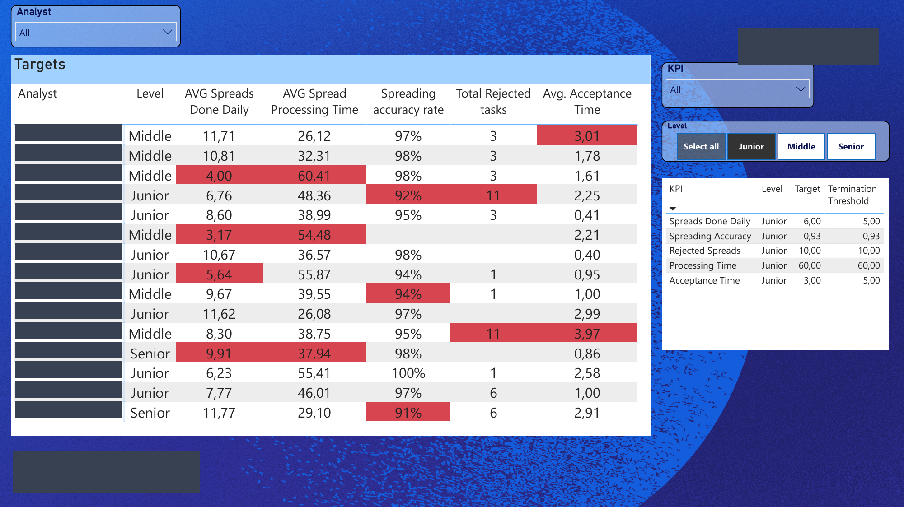
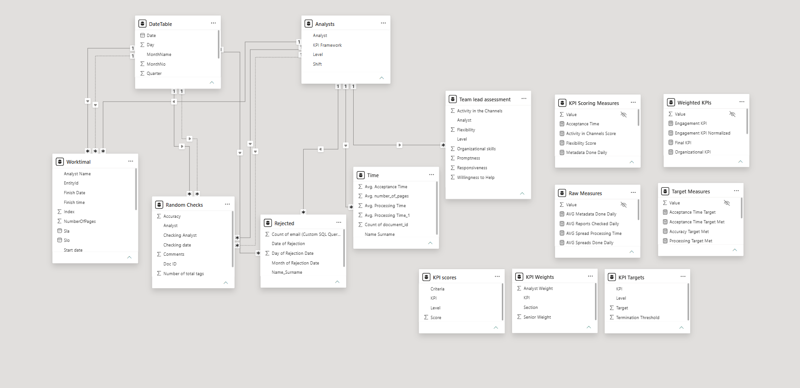

# Employee KPI Assessment Dashboard (Power BI)

A Power BI report that scores analysts each month against level-specific targets and combines the results into one weighted **Final KPI** per analyst, plus a team-level view.

## Summary

Our team's monthly evaluation process previously relied on spreadsheets and CSV files, and required manual work every month. This caused several problems:

- **Time-consuming:** data had to be collected from several separate sources (task exports, quality checks, rejected tasks, processing times, team-lead ratings) and combined by hand each month.
- **Error-prone:** copying and pasting between files, and matching analysts by name, made typos and mismatches easy (for example, the same analyst spelled differently in two exports).
- **Inconsistent scoring:** scoring rules, level-specific targets and part-time adjustments were applied manually, so results could differ between reviewers or months.
- **Hard to audit:** it was difficult to trace a final score back to the numbers behind it, or to see how weights and targets had been applied.
- **Difficult to change:** updating a weight or target meant editing formulas across files, with a risk of breaking earlier results.
- **No easy comparison:** looking at one analyst, one level or one KPI across months required rebuilding the analysis.
- **Static output:** results were delivered as flat tables, with no way to filter by analyst, level, shift or month.

This report:

- Pulls data from **Google Sheets, Excel and CSV exports** (task logs, quality checks, rejected tasks, processing/acceptance times, team-lead ratings), combined automatically from monthly files and tabs (one file per month in the `Tasks`, `Rejected` and `Time` folders, one Google Sheet tab per month for team-lead ratings), so history builds up month after month
- Scores **14 KPIs on a 1–5 scale**, grouped into three sections: **Spreading Skills**, **Organizational** and **Engagement**
- Uses **level-specific scoring bands** (Junior / Middle / Senior) for productivity and quality metrics
- Combines scores into a **Final KPI** using a weights table with separate columns for the *Analyst* and *Senior* frameworks
- **Skips KPIs that don't apply or have no data** and re-scales the remaining weights, so an analyst isn't penalized for a KPI that doesn't exist for their role
- **Pro-rates targets for part-time analysts** (4/7 of the full-time target) and expected working hours (4 h vs 6 h per day)
- Filters by month (single-select, synced across pages), analyst, level and shift

## Report pages

| Page | What it shows |
|---|---|
| **Overview** | Team Final KPI card, the three section KPIs, and an analyst-by-analyst KPI table. Slicers: Month, Analyst, Level, Shift. Buttons navigate to the section pages. |
| **Spreading Skills** | Spreads done daily, processing time, acceptance time, accuracy, rejected spreads, metadata done daily, reports checked daily. |
| **Organizational** | Responsiveness, Flexibility, Working Hours and Organizational Skills scores next to the core productivity scores. |
| **Engagement** | Promptness, Activity in Channels and Willingness to Help scores next to the core productivity scores. |
| **Targets** | Per-analyst actuals with a "Target Met" flag for each metric, plus a reference table of targets by KPI and level. |

### Overview

### Spreading Skills

### Organizational

### Engagement

### Targets

*Analyst names are masked in all screenshots.*

## Data model

**Data tables**
- `Worktimal` — task log (one row per task: start/finish, task type, analyst)
- `Random Checks` — quality-check results with accuracy per document
- `Rejected` — rejected tasks by date and analyst
- `Time` — average acceptance and processing time per analyst
- `Team lead assessment` — monthly 1–5 ratings from the team lead
- `Analysts`, `DateTable` — lookups (level, shift, KPI framework; calendar)

**Configuration tables** (created with *Enter Data*, so business rules live in data rather than in measures)
- `KPI Weights` — weight of every KPI, separately for the Analyst and Senior frameworks
- `KPI Targets` — target and termination threshold per KPI and level
- `KPI scores` — the 1–5 scoring rubric, for reference

**Measure tables** — `Raw Measures` → `Target Measures` → `KPI Scoring Measures` → `Weighted KPIs`

Design decision worth calling out: weights and targets are table-driven, so a manager can change how much a KPI counts without editing a measure. The 1–5 score bands themselves are written in DAX.

## Key measures

Full code in [`dax_measures.md`](dax_measures.md). Highlights:

- **`Final KPI`** — builds a small table of every KPI with its score and its weight (Analyst or Senior column), drops KPIs with no score or zero weight, and returns the weighted average over the weight that applies.
- **`Spreading Skills KPI Normalized`** — same idea per section: the weighted score divided by the weights of KPIs that actually have data.
- **`Spreads Done Daily` / `Processing Time` / `Spreading Accuracy`** — convert raw results into a 1–5 score using bands that depend on analyst level.
- **`Spreads Target Met`** — compares output with the level's target, pro-rated for part-time analysts.
- **`Team Final KPI`** — average Final KPI across analysts.

## Data transformation (Power Query)

Each month's files are dropped into a folder and appended automatically on refresh: task exports (Excel, `Tasks` folder), rejected tasks (CSV, `Rejected` folder) and processing/acceptance times (CSV, `Time` folder). The month is read from the file name (e.g. `September_2026.xlsx`), and a `FolderPath` parameter points to the main folder. Team-lead ratings come from a Google Sheet with one tab per month (named `Month_Year`), and quality checks from a second Google Sheet. The task log gets analyst names derived from worker emails and timestamps split into date and time columns. Every table carries a `Month` column, which a synced Month slicer filters through `DateTable`. Code with sources replaced by placeholders is in [`m_code.md`](m_code.md).

**Monthly refresh:** add the new month's files (and the new Google Sheet tab), then click Refresh. No query edits are needed.

## Tech stack

Power BI Desktop · DAX · Power Query (M) · Google Sheets / Excel / CSV

## Notes on this repo

This is a sanitized version of a report built for work. Analyst names, company branding and data source links are removed or replaced with placeholders.
